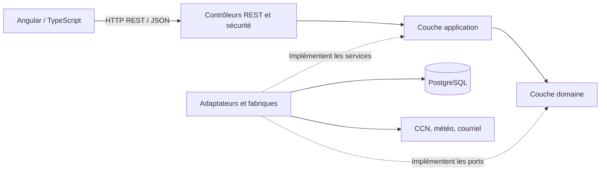
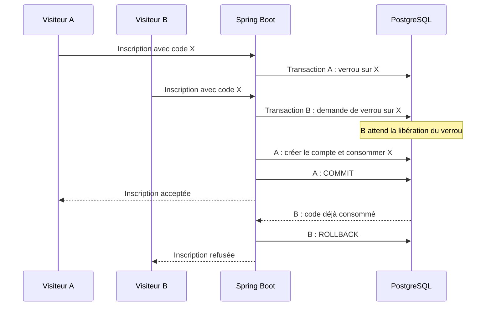
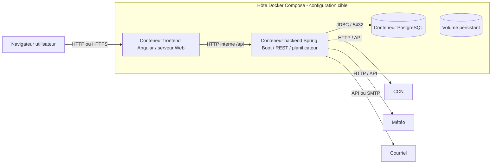
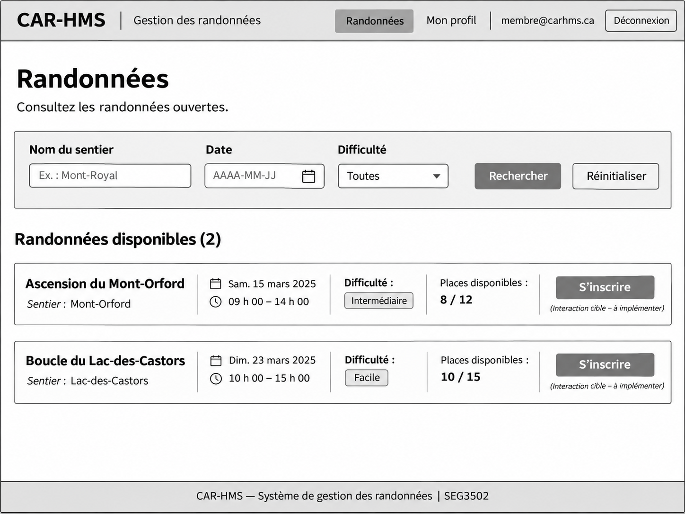
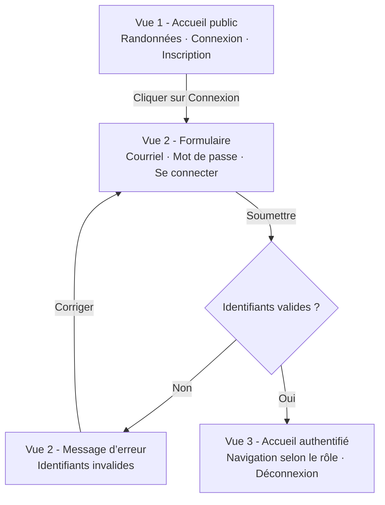
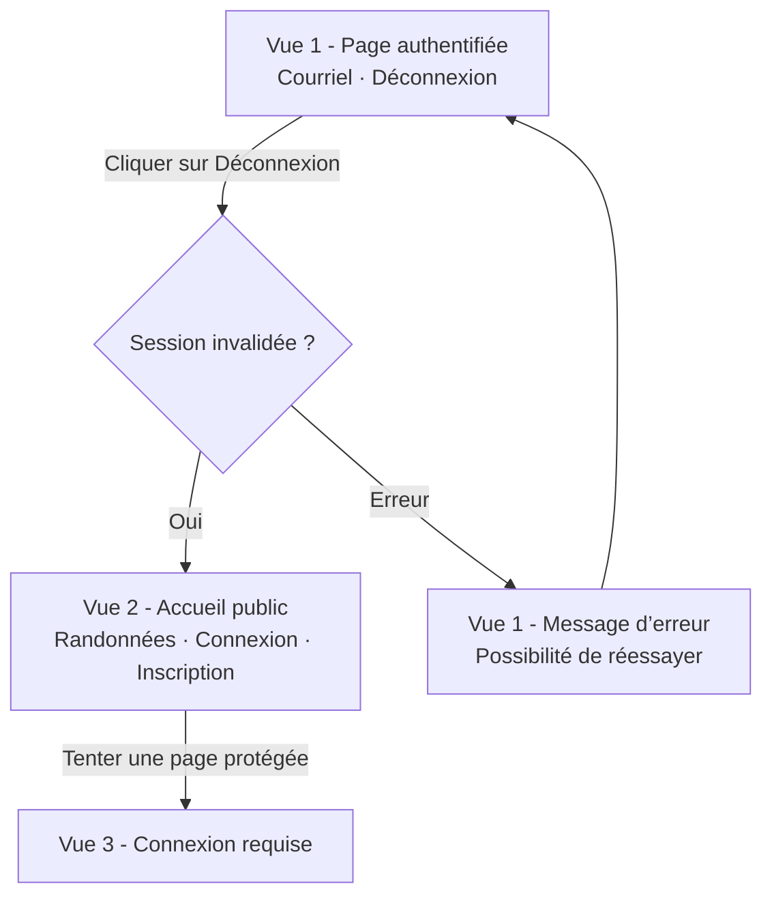
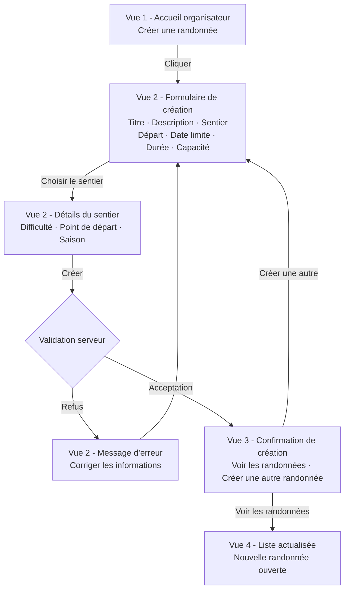
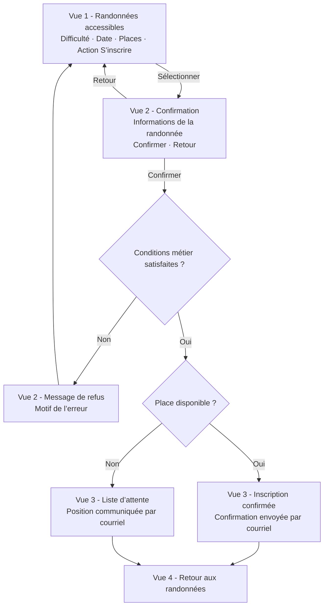

# Livrable 3 - Infrastructure et système complet

**Cairn - Système de gestion d’événements de randonnée (CAR-HMS)**

## 1. Page de couverture

| Information | Détail |
|---|---|
| Équipe | 2 |
| Projet | Cairn (CAR-HMS) |
| Date |  |
| Cours | SEG 3502 |
| Professeur | Kalonji Kalala |
| Livrable | 3 - Infrastructure et système complet |
| Dépôt | [SEG3502Lab/SEG3502Lab-Projet_CAR-HMS](https://github.com/SEG3502Lab/SEG3502Lab-Projet_CAR-HMS) |

| Membre | GitHub | Numéro d’étudiant |
|---|---|---|
| Mehdi Semmar | [MehdiSmr](https://github.com/MehdiSmr) | 300372426 |
| Salma Sajid | [SjSalma](https://github.com/SjSalma) | 300370622 |

## 2. Résumé

Destiné aux correcteurs de SEG 3502, ce document présente l’intégration de CAR-HMS avec Angular, Spring Boot et PostgreSQL, ses décisions architecturales, ses mécanismes de qualité et son interface.

## 3. Description de l’équipe et des rôles

| Membre | Responsabilités |
|---|---|
| Salma Sajid | Infrastructure commune (Angular, REST, sécurité, PostgreSQL, fabriques et dépôts), transactions ; parcourir les randonnées, enregistrer un randonneur, se connecter, se déconnecter, mettre à jour un randonneur et créer une randonnée ; sections 1 à 6 et déclaration IA individuelle. |
| Mehdi Semmar | S’inscrire à une randonnée, annuler une inscription, annuler une randonnée, fermer une randonnée, envoyer un rappel et générer un rapport d’utilisation des sentiers ; CCN, météo, courriel, planificateur, Docker Compose, README, intégration finale, vidéo de dix minutes et sections 8 et 9 ; déclaration IA individuelle. |

## 4. Hypothèses et modifications du domaine et de la couche applicative

Les hypothèses du livrable 2 restent applicables.

| No | Décision | Justification |
|---|---|---|
| H19 | Fuseau `America/Toronto`. | Référentiel horaire commun au club et au planificateur. |
| H20 | PostgreSQL et identifiants UUID. | Persistance et limitation des collisions. |
| H21 | Session HTTP ; statut d’organisateur dérivé de la certification. | Préserver le modèle du domaine. |
| H22 | Consultation publique des randonnées ouvertes, connexion, enregistrement par invitation et accès au jeton CSRF sans authentification. | Permettre l’accès des visiteurs et l’ouverture d’une session ; protéger les autres fonctions. |
| H23 | Comptes, codes et sentiers fictifs de démonstration ; sentiers initialisés avec `demo` et `local-dev`. | Tester avant l’intégration CCN ; ne pas réutiliser ces données fictives en production. |
| H24 | REST/JSON, `LocalDateTime` et durées ISO 8601. | Interopérabilité Angular/Kotlin. |
| H25 | Doubles de test conservés ; base H2 distincte. | Isoler les contrats de PostgreSQL. |

### 4.1 Modifications des couches existantes

| Élément | Modification et justification |
|---|---|
| `TrailRepository` | Ajout de `findAll()` et adaptation du double de test pour sélectionner les sentiers. |
| `ConsultationService` | Lecture des profils, des sentiers et du statut d’organisateur sans accès direct aux dépôts depuis les contrôleurs. |
| `RegisterHikerImpl` | Transaction unique pour le randonneur, le code d’invitation et le compte. |
| `HikesFacade` | Transactions autour des opérations de l’agrégat ; annotation Spring dans une façade déjà gérée par Spring, sans modification des règles métier. |

Les entités JPA restent distinctes des entités métier. Les modifications de l’intégration finale seront ajoutées ici.

## 5. Justification architecturale

### 5.1 Organisation générale

L’architecture conserve le domaine (agrégats, règles, interfaces de dépôts et fabriques) et l’application (cas d’utilisation et interfaces de services). Angular communique avec les contrôleurs REST, qui délèguent à l’application. Spring injecte les adaptateurs, fabriques et services ; les mappers JPA isolent le domaine de PostgreSQL.

### 5.2 Attributs de qualité

| Attribut | Mécanismes et limites |
|---|---|
| Authentification et autorisation | Spring Security, BCrypt, session HTTP et CSRF. `CurrentUserService` fournit l’identité ; les contrôleurs utilisent celle-ci plutôt que les courriels transmis par le client. Le serveur contrôle les rôles, l’identité et les certifications. Les guards Angular adaptent la navigation ; la déconnexion invalide la session. Exceptions publiques : H22. |
| Confidentialité | Mots de passe hachés, configuration PostgreSQL par environnement, profils accessibles au propriétaire ou à l’administrateur autorisé, résumés publics sans données personnelles de profil. HTTPS, protection des volumes et sauvegardes restent à configurer pour un déploiement réel. |
| Indisponibilité des services externes | Adaptateurs isolant les fournisseurs ; sentiers persistés localement ; interception de `WeatherServiceUnavailableException` pour envoyer un rappel sans alerte météo. Les fournisseurs réels et les scénarios de panne restent à intégrer ; le courriel de développement est simulé. |

### 5.3 Concurrence et déploiement

#### Style architectural et concurrence

Le système est une SPA Angular à client riche et serveur centralisé : le navigateur gère la présentation et les appels asynchrones, tandis que Spring Boot traite les requêtes concurrentes, les règles métier et les transactions via un pool de connexions PostgreSQL.

Le verrouillage pessimiste JPA (`PESSIMISTIC_WRITE`) protège les codes d’invitation et les randonnées pendant les transactions de lecture-modification-sauvegarde. L’inscription au club regroupe la consommation du code et la création du compte ; les modifications de randonnée regroupent les règles de capacité et de liste d’attente. Les contraintes d’unicité complètent ces protections pour les courriels et certificats.

Ce scénario décrit le comportement attendu, non un test de concurrence réussi. Les accès simultanés aux profils, les rappels et le planificateur restent à vérifier lors de l’intégration.

#### Diagramme de déploiement

Le déploiement cible sépare frontend, backend et base privée ; `/api` est relayé vers le backend, qui héberge le planificateur.

Le diagramme sera aligné sur le Docker Compose final. En développement : Angular 4200, Spring Boot 8080, PostgreSQL 5433 (port hôte).

## 6. Conception de l’expérience utilisateur

### 6.1 Maquette filaire de l’interface

La navigation dépend du rôle. La maquette représente la consultation par un randonneur connecté ; l’action d’inscription est prévue pour l’intégration finale. Les données illustratives ne sont pas des données CCN validées.

*Figure 1 — Maquette filaire de la page de consultation des randonnées.*

| Rôle | Navigation et actions |
|---|---|
| Visiteur | Randonnées, Connexion, Inscription au club par invitation. |
| Randonneur | Randonnées, Mon profil, Déconnexion ; inscription aux randonnées et gestion de ses inscriptions après intégration. |
| Organisateur | Navigation du randonneur et Créer une randonnée ; annulation de ses randonnées après intégration. |
| Administrateur | Randonnées, Administration, Déconnexion ; annulation autorisée et rapport après intégration. |

Les formulaires présentent des champs obligatoires et des messages de succès ou d’erreur ; le serveur valide les règles métier et les droits. Les cartes s’adaptent aux écrans étroits.

### 6.2 Storyboard - Connexion

### 6.3 Storyboard - Déconnexion

### 6.4 Storyboard - Créer une randonnée

### 6.5 Storyboard - S’inscrire à une randonnée

Flux cible : authentification, adhésion active, niveau compatible et confirmation ; inscription ou position d’attente communiquée par courriel.

Les randonnées complètes admissibles à la liste d’attente devront être accessibles aux membres ; la consultation publique reste limitée aux randonnées ouvertes.

## 7. Déclaration relative à l’IA générative

Salma Sajid : ChatGPT (GPT-6.2) a aidé à implémenter l’infrastructure Kotlin/Spring Boot, la persistance JPA, la sécurité, les transactions et le frontend Angular, ainsi qu’à rédiger la documentation et les storyboards. Son outil de génération d’images a produit la maquette filaire de la section 6.1 à partir des exigences et de la structure de CAR-HMS.

Les résultats ont été contrôlés par compilation, tests Gradle et Angular et essais manuels des fonctionnalités déjà vérifiées. Les 84 tests Kotlin et les 8 tests Angular ont réussi ; la création de randonnée de bout en bout et les accès concurrents restent à confirmer. La maquette et les storyboards doivent être relus par l’équipe avant la remise.

La déclaration de Mehdi Semmar reste à compléter.

## 8. Démonstration

## 9. Références

